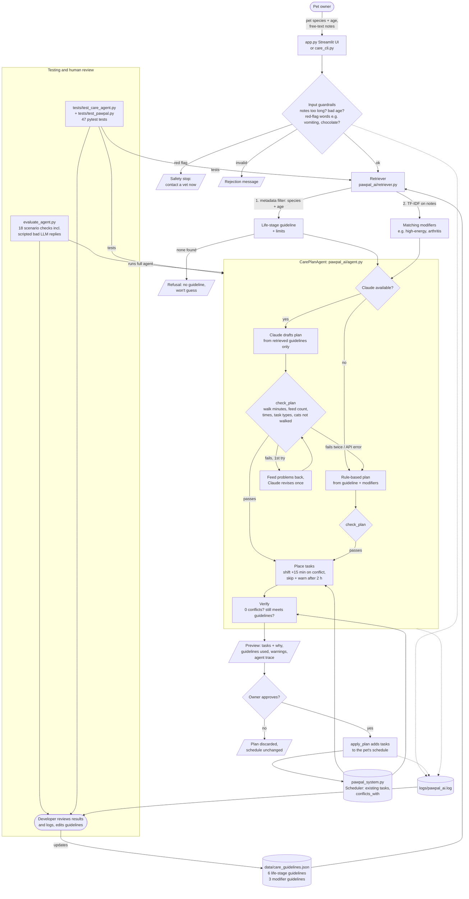

# PawPal+ AI Care Plan: System Diagram

## Reading the diagram

- **Data flow:** owner input, then guardrails, then retrieval (life-stage guideline plus modifiers), then the agent loop (plan, check, revise, place, verify), then a preview, the owner's approval and the schedule.
- **RAG drives the plan:** the retrieved guidelines provide the baseline tasks, the limits the plan is checked against, and the only context Claude is given.
- **Agentic loop:** the agent checks its own draft, sends problems back for one revision, falls back to a safe rule-based plan, and uses the existing `Scheduler` to place tasks around existing bookings.
- **Humans in the loop:** nothing is added until the owner approves. The developer uses the evaluation report, the tests and the log to improve the guidelines.
- **Safe failure:** red-flag symptoms, unsupported species, invalid input and LLM errors each end in a clear message or a fallback, never a guessed plan.
